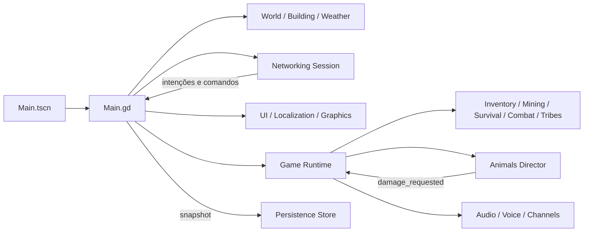

# Diagnóstico inicial — antes das alterações de reconstrução

Criador: **felipealx**. Base auditada: **0.3.1-dev / 18bb0cc**. Este diagnóstico
foi registrado antes de autorizar alterações na aplicação, conforme seção 1 de
[REQUEST_RECONSTRUCTION.md](REQUEST_RECONSTRUCTION.md). A importação apenas criou
um UID de teste; nenhum código funcional foi modificado durante a auditoria.

## Estrutura e dependências verificadas

O inventário contém 246 arquivos de fonte/recursos, 42 scripts runtime, uma cena,
28 assets binários/shaders e 151 referências literais. Nenhuma referência literal
runtime quebrada ou duplicação binária por SHA256 foi encontrada. As referências
qa_locate.gd/qa_userdir.txt inexistentes são geradas deliberadamente por um teste.
Detalhes: reconstruction-audit/before/resource-inventory.json.

- `Scenes/Main.tscn` tem um Node `TribesOfFire` com `Main.gd`; é a única cena de
  entrada. Não há autoloads na base auditada.
- Main cria World, Session, HUD e câmera; aguarda World.generate e cria Runtime,
  chat e overlay. Runtime instancia Audio, Voice, Mining, Wildlife e fonte potável.
- World cria 64 malhas de terreno e 64 colisores, 160 árvores, céu/sol/lua/nuvens,
  grama MultiMesh, água/probe e chuva/áudio. Campfire e Shelter são nós criados por
  scripts, sem cenas externas. Building contém esses prefabs e Workshop.
- Player cria cápsula, avatar, SpringArm, câmera e nome. Appearance/Rig/Equipment
  constroem o personagem e Skeleton3D com nove ossos; não há GLB ou biblioteca de
  AnimationPlayer importada. Animais também são modelos/animações procedurais.
- Core/Items/Survival/Combat/Tribes/Channels são regras usadas pelo Runtime, não
  sistemas fictícios desconectados. Exceção: Tribes.can_build não é chamado.
- Graphics/Settings e Localization/Manager são RefCounted criados por Main. HUD
  cria painéis e conecta sinais dos controles depois de inicializar seus valores.
- Assets inclui shaders, fonte Noto CJK, ícone e WAV originais. Licenças são
  distribuídas pelo empacotador. Não foi identificada dependência paga obrigatória.

Session.peer_joined/peer_left cria/remove atores; intent_received aplica intenção;
action_received/command_received entram na fila da física; state_received aplica
réplicas; failed volta ao menu. Runtime conecta event_received, voice_requested e
Wildlife.damage_requested. Player.respawned reinicia Needs/Exposure. O caminho de
Session é idêntico nos peers. Sinais e criação são explícitos nos scripts.

Engine executado: **4.6.3.stable.official.7d41c59c4**. Features do projeto ainda
indicam 4.3. Renderer **Compatibility**, física60Hz. Presets de exportação release
x64 com PCK embutido: Windows, Linux e Linux dedicado. Testes/Tools/pacotes não
entram no jogo exportado; documentação/licenças acompanham a distribuição.

## Console e execução inicial de cinco minutos

Importação e cena real com movimento automatizado por **300,049749 s monotônicos**
no Xorg virtual, OpenGL/Mesa llvmpipe, Muito Baixo/safe, áudio Dummy e perfil
isolado. **Saída 0; nenhum SCRIPT ERROR/ERROR ou aviso de vazamento.** Único aviso:
VSync indisponível no display virtual. Não equivale a jogar manualmente no Windows.

5.117 frames, média **17,0538 FPS**, 2.188 nós constantes; memória estática Godot
102.095.654–102.435.954 bytes. RSS amostrado só na segunda metade da sessão:
495.716–526.348 KiB; não é prova de ausência de vazamento a longo prazo. Dois
snapshots válidos SHA256, sequência final7, um jogador, lock liberado.

[Captura anterior](reconstruction-audit/before/baseline-gameplay.png), logs e JSON
em reconstruction-audit/before/. A imagem confirma a crítica visual: copas
esféricas, grama triangular esparsa, personagem geométrico e teclas no rodapé.
O desempenho em software não representa uma GPU física nem certifica60FPS.

Outras execuções: test_world25/0 e ENet servidor+2clientes passaram. Fixtures
isolados reproduziram cada defeito marcado como confirmado abaixo. A primeira
execução de um fixture sem XDG tentou gravar no HOME somente leitura; repetição
isolada passou. Esse erro de ambiente não foi classificado como crash do jogo.

## Problemas por gravidade

Não foi reproduzido novo defeito **Crítico** de corrupção ou impossibilidade de
abrir nesta base. Ausência de reprodução não comprova inexistência de defeitos.

| ID / gravidade | Diagnóstico e evidência | Estado inicial |
|---|---|---|
| A01 Alto | Preset só altera pending e não é salvo; reabrir painel descarta escolha. Alto+resolução expira15s e restaura também qualidade antiga. Reprodução Main real. Graphics/Settings.gd e UI/GraphicsPanel.gd. | Confirmado |
| A02 Alto | graphics.cfg e settings.cfg disputam preferências; Main regrava vídeo legado. Nenhum autoload Settings. Não foi encontrado autoajuste periódico oculto. | Confirmado por leitura |
| A03 Alto | Corte atravessa parede e alcance vertical ignora25m; três golpes mantêm machado100% e concedem4madeiras diretamente. World.nearest_tree/Main._receive_action. | Reproduzido |
| A04 Alto | Teto físico bloqueia partículas mas não dano por não integrar rain_roof. World.is_sheltered. | Reproduzido |
| A05 Alto | Javali/urso/raposa iniciam ataques sem provocação; hostilidade depende de damage>0. Coelho/veado fogem, lobo predador funciona parcialmente. | Reproduzido |
| A06 Alto | Inventário completo/slots/desgaste/necessidades de terceiros constam em snapshots enviados a todos. Não concede modificação, mas expõe estado privado. | Confirmado |
| A07 Alto | Água/cozimento/estações funcionam através de parede, usando só distância. Dono de bancada é salvo mas não aplicado. | Reproduzido |
| A08 Alto, ausente | Mundo tem seed1337, terreno independe de seed, sem streaming/biomas/cavernas/ruínas. Store/Player/fauna também fixam dimensões. | Confirmado |
| A09 Alto, ausente | Madeira não cai no chão, coleta é imediata, árvores/depósitos/fauna são finitos sem rebrota/população. | Confirmado |
| A10 Alto, ausente | Construção só prefabs; faltam peças modulares, portas, cama/baú, encaixe/rotação/integridade e proteção territorial. | Confirmado |
| A11 Alto, latente | package.py usa os.walk e inclui arquivo ignorado como export_credentials.cfg/.env se existir. Nenhum segredo desse tipo foi encontrado/distribuído nesta auditoria. | Risco confirmado pelo empacotador |
| M01 Médio | Campfire sem combustível/extinção; calor atravessa parede; trovão com atraso aleatório sem posição do evento. | Leitura/reprodução calor |
| M02 Médio | RPC remoto clima é recusado, porém host/solo alteram clima em release por HUD/Main. HUD exibe lista permanente de teclas/debug. | Confirmado |
| M03 Médio | craft_fire legado falha com36slots se custo liberaria slot; craft_recipe transacional funciona. | Reproduzido |
| M04 Médio | Preset não redefine todas opções; render_scale/rain não viram Custom. apply_camera não é chamado no spawn. Resoluções fixas; sem ui_scale/DPI. | Confirmado |
| M05 Médio | Grade fauna±60m e clamp±59; navegação/detecção ignoram vários obstáculos, flee_left/target_peer não decidem estados. | Confirmado |
| M06 Médio | Rede envia mundo completo confiável10Hz; corte recria bases e oculta árvore sem queda; uma bolsa alterada recria coleção inteira. | Confirmado |
| M07 Médio | 64 terrenos sempre ativos, grama global4200, folhas materiais individuais; personagem101nós/73meshes; animais18–23meshes/instância. | Contagem real/arquitetura |
| M08 Médio | Durabilidade por tipo, pilhas9999 ignoram stack do catálogo; ferramentas avançadas sem diferença de velocidade/rendimento. | Confirmado |
| M09 Médio | Token ENet não criptografado, sem senha/descoberta/autenticação comercial. Voz sob carga teve falha anterior sem causa demonstrada. | Limitações conhecidas |
| M10 Médio | Preview UI e captura antiga não representam jogo atual; testes de rede com cronogramas fixos e QA Windows preso a schema3/seed1337/±61. | Confirmado |
| M11 Médio | Mutação social serializa histórico completo para orçamento; schema tribal aceita algumas inconsistências/duplicatas. | Leitura, sem crash observado |
| B01 Baixo | Campos órfãos Mining.hits, Animal.target_peer, Director._replica_hash, Player._airborne; dados de stack/durability não aplicados. | Leitura |
| B02 Baixo | Appearance constrói duas vezes no spawn; áudio animal repetido por instância; rig copia ossos mesmo distante/dedicado. | Leitura |
| B03 Baixo | Logger sempre ativo sem nível/sistema; HUD/chat usam tamanhos fixos; texto técnico antigo precisa revisão linguística. | Leitura |
| B04 Baixo | Downloads/README anuncia0.3.0; helpers antigos de captura precisam confirmação de aparência. | Leitura |

Não foi identificada dupla conexão recorrente nem referência literal runtime
quebrada no inventário. Há caminhos internos acoplados a nós construídos pelo
próprio script (Knee/Rig/Equipment); serão substituídos por referências quando
alterarmos esses modelos. Await de geração e timers de fechamento/preview exigem
cuidado; o shutdown da0.3.1 já cancela geração. Fixtures externos que quitam
abruptamente podem vazar recursos; isso não foi observado no baseline5min real.

## Área medida e compatibilidade

Malha atual: **128×128m =16.384m²**. Clamp do jogador±60 dá exploração efetiva
**120×120m =14.400m²**. A expansão proposta320×320m =102.400m² é6,25× a malha e
7,11× a área explorável; mesmo margem marítima de2m mantém316²=99.856m².
Alterar só LIMIT quebraria saves/fauna/coordenadas; descriptor versionado precisa
preservar gerador legado e seed1337 dos mundos existentes.

## Dados salvos e perdas conhecidas

Store usa user://world ou --save-dir, envelopes JSON alternados com sequência,
payload, SHA256, temporário validado e .writer-lock; schema3 migra v1/v2, envelope
16MiB/payload8MiB e até1024perfis. Salva posição/HP/regeneração, inventário/slots/
equipamento/desgaste/aparência, fome/sede/exposição, cortes/fogueiras/abrigos,
clima/hora, fauna, mineração, oficinas/donos, bolsas/desgaste, tribos/proteções,
grupos/bloqueios. Manual, autosave45s e saída normal. Preferências e identity.cfg
ficam fora da instalação; identidade preserva o perfil, não é autenticação comercial.

Chat/voz não são gravados. Chamadas/convites pedem novo aceite após reinício.
Dano parcial de árvore/estados transitórios de combate não persistem. Crash pode
perder o período desde último save e deixa lock; não existe WAL/fsync garantido.
Os dois slots inválidos são corretamente recusados, sem gerar mundo vazio.

## Ordem autorizada para as correções após este diagnóstico

1. Settings único, persistência imediata e rollback apenas do display; reproduzir
   todos presets por120s reais e reinício; corrigir bugs altos de coleta/teto/IA.
2. Proteger estado privado, bloquear clima release também no servidor, aplicar
   permissões/oclusão e reforçar handshake/RPC/limites sem alegar segurança comercial.
3. Descriptor/schema4 e geração por seed/chunks, expandindo mapa sem mudar saves
   antigos; construção modular/coleta/respawns/fogo conectados ao Runtime.
4. Reconstruir malhas, vegetação, terreno/água e animações; limpar HUD e opções de
   depuração públicas. Capturar antes/depois nas mesmas condições quando possível.
5. Importar e executar Main a cada integração; depois testes completos, cenários
   de rede, presets/modosjanela, longa duração30min, exports e instalador nativo.
   Cada ausência de teste e funcionalidade continua pendente até observação real.

A reconstrução ainda não começou neste diagnóstico; nenhuma linha desta lista
significa que o requisito já foi corrigido. Resultados posteriores serão registrados
separadamente, mantendo esta evidência do estado original.

## Complemento Parte2 recebido antes das correções

[REQUEST_RECONSTRUCTION_PART2.md](REQUEST_RECONSTRUCTION_PART2.md) foi lido após
concluir esta auditoria e antes de começar alterações. Nenhum item acima foi
corrigido ainda. As seções22–41 acrescentam progressão/pesquisa, filas/reparo,
pesca/agricultura/domesticação, condições de combate, estações, diplomacia/NPCs,
diário/mapa, acessibilidade/controle, administração/configuração de servidor e
produção. A seção22.6 permite entregar uma versão mínima funcional dos sistemas
grandes e registrar o restante como pendência. Essa permissão não torna um painel
vazio uma implementação nem dispensa persistência, autoridade, interface e testes.

A sequência inicial de correção permanece: estabilidade/presets/altoimpacto,
segurança, mundo/mecânicas, visual e produção. Funcionalidades adicionais serão
integradas por ciclos verificáveis; extensões não executadas continuam pendentes.
